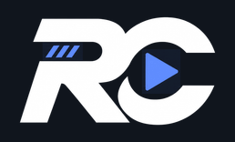

#  ReadyClip

ReadyClip turns action-camera footage into highlight reels on your Windows PC. It detects audio peaks, keeps the footage around each moment, and joins the selected sections into an MP4.

## Windows beta

The first beta targets 64-bit Windows. ReadyClip can export a lossless video master, use automatic hardware encoding with CPU fallback, and create optional four-minute clips.

The Windows installer will be available under [Releases](https://github.com/colornhue/ReadyClip/releases) when the beta is published.
